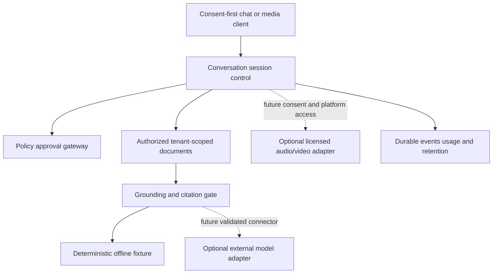

# REA Intake: Saaya → Governed Conversation Runtime (2026-10-18)

**Source URL:** https://www.reddit.com/r/indiehackersindia/s/4SJs7GODir
**Resolved:** https://www.reddit.com/r/indiehackersindia/comments/1x9bbay/saaya_an_ai_agent_that_tutors_mentors_and/
**Site:** https://saaya.ai
**Upstream code:** none reviewed or used; no public upstream repository/license established.
**Governance:** https://github.com/rrahul0904/agent-work-os/issues/299
**Route:** donor/extension of THIS existing Agentic Company OS repository. No separate clone or repo.
**Evidence boundary:** only public marketing pages, public docs, pricing and legal pages. No signup, APIs, traffic interception, source extraction or authenticated product testing.

## Findings, evidence confidence and unknowns

| Claim or product behavior | Public source | Evidence grade | Notes |
| --- | --- | --- | --- |
| Founder frames it as regional-language tutor/mentor/interview partner | [Reddit launch](https://www.reddit.com/r/indiehackersindia/comments/1x9bbay/saaya_an_ai_agent_that_tutors_mentors_and/) | founder claim | launch-day positioning, not a usage test |
| Enterprise agents across voice/video/chat | [Home](https://saaya.ai/) | advertised | not tested end to end |
| Interrupted voice conversations, visual signals, cross-channel continuity | [Home](https://saaya.ai/) | advertised demonstration | latency, true video perception, continuity and accuracy unverified |
| Indian speech + Google Gemini | [Home](https://saaya.ai/) | first-party provider disclosure | dependency contracts, routing and actual configurations unknown |
| Knowledge-base retrieval tuned with relevance and top-k | [Knowledge bases](https://saaya.ai/docs/knowledge-bases) | documented intended behavior | document says automatic resync preference does not yet perform scheduled refreshing |
| Draft/publish/version rollback | [Versioning](https://saaya.ai/docs/versioning) | documented contract | production rollback performance untested |
| REST API and MCP entrypoints | [Docs](https://saaya.ai/docs) and [API](https://saaya.ai/docs/api) | documented interface | no calls made; documentation is NOT an implementation license |
| Free offer and USD plan tiers | [Pricing](https://saaya.ai/pricing) | advertised prices | free includes 15 one-time call minutes; $59/$149/$389/$999 per month advertised for US/unknown regions; paid purchasing publicly listed as not yet open; tax extra; do not represent quotes as bills |
| Proprietary legal restriction | [Terms, 2026-10-15](https://saaya.ai/legal/terms) | explicit restriction | ban on using Service to reverse-engineer, extract models or develop directly competing product; do not use Saaya Service for this project |

**Reddit comment evidence:** A commenter recommends focusing positioning on source-grounded tutoring rather than four buyer personas. This is one person's unsolicited feedback, not market validation.

**Unverified:** public availability of live video; speech latency; objective language support/quality; avatar lifelike behavior; multilingual interruption; source-only accuracy; telephony/WhatsApp integration readiness; privacy/security assurance; cost/margin; adoption; production scaling. None is marked as independently tested.

## Product placement and differentiated thesis

Existing Agentic Company OS has workspace/business context, named agents, a delegation planner, policy/approval gateway, audit and cost ledger. Its own `docs/FEATURE_MATRIX.md` already marks **voice** connector-ready, **chat widget** planned, and **eval harness** planned.

A whole new SaaS would duplicate tenants, permissions, prompts, billing and workflows. Instead build a **consent-aware conversation lane** that any existing authorized agent can use. Initial value proposition: local-first, audit-friendly business/education conversations with document-grounded answers, visible uncertainty and human escalation. Not a lookalike, AI twin impersonation, or cloned service.

Other repo consumers (only after contracts stabilize): AcademyOS AI for optional educational sessions; separate interview practice project for disclosed, permitted mock interview conversations. Do not merge distinct product ownership.

## Original architecture proposal (not a description of Saaya internals)



### Contract sketch

- Session: `session_id, workspace_id, agent_id, channel, locale, provider_config_version, consent, recording_consent, state, budget`.
- Events: `session.started, knowledge.attached, turn.completed, session.interrupted, session.resumed, action.approval_required, session.closed`; event payload excludes raw transcript by default.
- Source-grounded answer: `answer, source_ids, abstained, channel, language`. **Fail closed** on insufficient evidence.
- Live response streaming/translation: **NOT IMPLEMENTED**; future adapters may only claim support with e2e tests and provider access.
- Actions: propose only, delegate to established Policy/Approval Gateway for authorizations; no auto-sending, calling or payment from conversation output.
- Media: retain the distinction between a session labeled `voice/video` and actual working audio/video transport. Phase 0 is metadata-only.
- Tenant isolation must be enforced on every request, retention must be separately consented to, and idempotency keys must reject payload collisions.

## Implemented Phase 0 slice (isolated, no provider credentials)

- `prototype/conversation.py`: dependency-free, in-memory deterministic ConversationSession with explicit session consent; separate transcript-retention consent; workspace authorization; lexical source retrieval and abstention; bounded question/source/turn limits; same-key collision detection; interrupt/resume/close lifecycle; non-executing approval requests; no media or model integration.
- `prototype/tests/test_conversation.py`: consent, workspace isolation, evidence/abstention, bounded/idempotent turns, lifecycle, action approval and transcript tests.
- Lexical source matching is **not** a RAG/vector retrieval engine, a translation system, or a reliable factual-answering product. Source snippets remain untrusted input. Injection resistance must be evaluated against a real model when integrated.
- No persistent storage, web service endpoint, call/telephony, media, spoken languages, human avatar, marketing site, payment processor, outbound notifications or deployment are included.

## Roadmap & acceptance gates

| Phase | Deliverable | Proof required | State |
| --- | --- | --- | --- |
| 0 — Source/dedupe | provenance ledger, clean-room routing, deterministic fixture | review plus unit tests | files committed; runtime test pending |
| 1 — Back-end chat | workspace-isolated API, persistent events, source citations, redaction, token budgets | CI and isolated e2e fixtures | not started |
| 2 — Speech | explicit consented realtime voice transport, interrupts, locale switches, provider fallback | own licensed adapter; measured P50/P95, failure/retry | not started |
| 3 — Video | user-initiated camera consent, optional avatar, accessible captions, clear AI disclosure | privacy review and browser/mobile tests | not started |
| 4 — Enterprise | RBAC, lawful WhatsApp/PSTN opt-ins, HMAC/webhooks, retention policies, handoff routing | security, rate-limit, load, accessibility and policy UAT | not started |
| 5 — Ship | tagged, reviewed release and operator runbook | exact SHA evidence + approvals + deploy gate | blocked |

### Mandatory negative tests for next phase

- refusal/abstention when knowledge lacks support, wrong-tenant source, citation mismatch;
- prompt injection embedded in a document cannot change tool policy;
- replay or duplicate event cannot duplicate a charged turn or side-effect;
- user interrupt cancels downstream speech promptly and no speech leaks after close;
- no media capture before consent, transcript not persisted without separate consent;
- minors require appropriate safeguards, and healthcare use remains informational/administrative, not medical advice;
- outbound messages, financial actions, real-person likeness/voice clones must require necessary authorization, verified consent and approval;
- expired data, provider outage, backpressure, PII leak, malicious file and high latency fall back safely.

## Reproducible verification

```bash
python3 -m unittest discover -s prototype/tests -v
```

**Evidence status:** test source is committed, but execution verification is not claimed until a CI result or captured local test receipt confirms it. No PR merge, deployment, provider-side calls or production readiness has been authorized.

**Legal & product note:** Saaya's terms explicitly restrict reverse engineering and use of its service to build a directly competing product. All work here is independent development of general-purpose conversation capabilities within an already owned agent system, based on standard patterns. Do not use the service itself, its protected creative assets, prompts or undocumented internals; seek legal review before any competitive launch.
